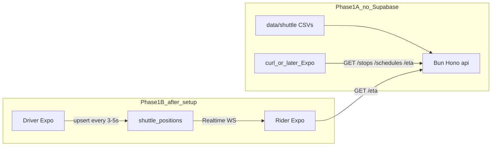

# Shuttle MVP scaffold (deepened, API-first)

Continues where you left off: **step 0 CSVs are done**. You do **not** have a Supabase project yet — so this plan ships value without it first, then gates live GPS on setup.

**Plan home:** [`HawkNav-seb/.cursor/plans/shuttle_mvp_scaffold.plan.md`](shuttle_mvp_scaffold.plan.md) (repo copy).

## Already done

[`data/shuttle/`](../../data/shuttle/) lean CSVs:

- `meta.csv` — `term`, `updated_at`, `name`, `email`
- `stops.csv` — `stop_id`, `name`, `lat`, `lng`, `routes`, `status`
- `off_campus.csv` / `on_campus.csv` / `pearland.csv` — `day_group`, `stop_id`, `times`
- Loader/validator belongs in the Bun API ([`data/shuttle/README.md`](../../data/shuttle/README.md))

## Constraint

**No Supabase project yet.** Phase 1A does not call Supabase. Phase 1B starts only after you create a project and paste keys into gitignored `.env`.

## Layout (shallow)

```text
HawkNav-seb/
  .cursor/plans/shuttle_mvp_scaffold.plan.md
  data/shuttle/     # DONE (+ fill missing coords)
  api/              # Phase 1A — Bun + Hono (CSV only)
  supabase/         # Phase 1B — schema.sql (ready before or at gate)
  mobile/           # Phase 1B — Expo after keys exist
  .env.example
  README.md
```

## Data flow



---

## Phase 1A — no Supabase required

### 0. Stop coordinates

- Fill empty lat/lng: `bay_area_park_ride`, `united_way_houston`, `coastal_flow`, `anytime_fitness`, `heb`
- Leave `tmc` inactive; bump `meta.csv` `updated_at`

### 1. API — `api/`

Bun + Hono, shallow `src/`. **CSV only** — no Supabase client in this phase.

- **`csv.ts`** — parse + validate `meta`, `stops`, route CSVs
- **`GET /health`** — ok + `term` / `updated_at`
- **`GET /stops`** — active stops (optional `?route=`)
- **`GET /schedules`** — `?route=off_campus|on_campus|pearland` + optional `day_group`
- **`GET /eta?stop_id=`** — next departure for today in `America/Chicago`
- `bun run dev`

### 2. Docs for API-only

- `.env.example` + `README.md` for API-only; Supabase marked Phase 1B

**Exit criteria:** curl `/health`, `/stops`, `/schedules`, `/eta` work with no cloud account.

---

## Phase 1B — Supabase setup gate, then live GPS

### 3. Manual setup (you do this once)

1. Create a free project at supabase.com
2. Copy Project URL + anon key into `.env` (never commit)
3. Run `supabase/schema.sql` in the SQL editor
4. Enable Realtime for `shuttle_positions`

### 4. Schema — `supabase/schema.sql`

- Table `shuttle_positions` + Realtime + MVP RLS
- Optional empty `shuttle_stops` stub; schedules stay on CSVs

### 5. Expo — `mobile/`

Driver GPS upsert + Rider realtime + ETA stop picker after keys exist.

---

## Out of scope (later)

Mapbox / nearest-stop UI, background GPS hardening, multi-shuttle shifts, historical moving-average ETA, Cloudflare tunnels, Auth/2FA.
