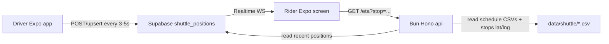

# Shuttle MVP — start building

## Scope

Build the **Shuttle Team** slice only (per [PROJECT_CONTEXT.md](PROJECT_CONTEXT.md)): driver GPS every 3–5s → Supabase realtime → rider UI, plus a Hono ETA stub. No map/360/parking modules.

## Layout (shallow)

```text
HawkNav-seb/
  data/shuttle/     # CSV schedules + stops lat/lng (step 0)
  mobile/           # Expo Go (React Native) — driver + rider screens
  api/              # Bun + Hono — health + ETA stub
  supabase/         # SQL schema for shuttle_positions + realtime
  .env.example      # public placeholders only
  README.md         # how to run
```

No packages/, shared libs, or deep nesting until something is reused twice.

## 0. Shuttle schedule CSVs — [`data/shuttle/`](data/shuttle/)

Do this **before** wiring ETA to live GPS.

- **Source of truth = CSV** (edit in Excel → Save As CSV). No workbook required.
- [`stops.csv`](data/shuttle/stops.csv): every stop’s `stop_id` + **lat/lng**. Add / update / remove stops by editing this file (exact coordinates).
- Route files: `off_campus.csv`, `on_campus.csv`, `pearland.csv`, `medical_center.csv` — times join on `stop_id`.
- [`meta.json`](data/shuttle/meta.json) / `meta.csv`: term + version string for the app.
- Validate: `python3 data/shuttle/validate_stops.py`
- Details: [`data/shuttle/README.md`](data/shuttle/README.md)

## Data flow



## 1. Supabase schema — [`supabase/schema.sql`](supabase/schema.sql)

- Table `shuttle_positions`: `id`, `shuttle_id`, `lat`, `lng`, `heading`, `updated_at`
- Enable Realtime on that table
- Simple RLS: authenticated write for drivers later; for MVP allow service-role / anon insert with a comment that production tightens this
- Optional `shuttle_stops` stub table for ETA later (seed from `data/shuttle/stops.csv`)

## 2. Expo app — [`mobile/`](mobile/)

- `npx create-expo-app` (TypeScript template)
- Deps: `expo-location`, `expo-task-manager`, `@supabase/supabase-js`
- Screens:
  - **Driver:** Start/Stop streaming; `watchPositionAsync` (foreground MVP) every ~4s; upsert `{lat,lng,heading}` to `shuttle_positions`
  - **Rider:** Subscribe to realtime changes; show last lat/lng/heading + “last updated” (map pin can come next)
- Config via `EXPO_PUBLIC_SUPABASE_URL` / `EXPO_PUBLIC_SUPABASE_ANON_KEY`
- Comment why interval is 3–5s (battery vs freshness)

## 3. Hono API — [`api/`](api/)

- Bun + Hono: `GET /health`, `GET /eta?shuttle_id=&stop_id=` returning a stub ETA (moving-average placeholder)
- Read schedule next-departure from `data/shuttle/*.csv`; map pins from `stops.csv` lat/lng; show `meta.json` version
- Read-only Supabase client using service role from env (never ship that key in the mobile app)
- `bun run dev` script

## 4. Docs / env

- Root [`.env.example`](.env.example) and short [`README.md`](README.md): create Supabase project → run `schema.sql` → copy keys → run `api` and `mobile`
- Keep secrets out of git (already in [`.gitignore`](.gitignore))

## Out of scope for this pass

- Auth / 2FA, Mapbox map, background TaskManager hardening beyond a stub hook, real historical ETA math, Cloudflare tunnel wiring (document as next step)

## Assumption

You will plug in a real Supabase project URL/keys after scaffold; we will not commit secrets.
